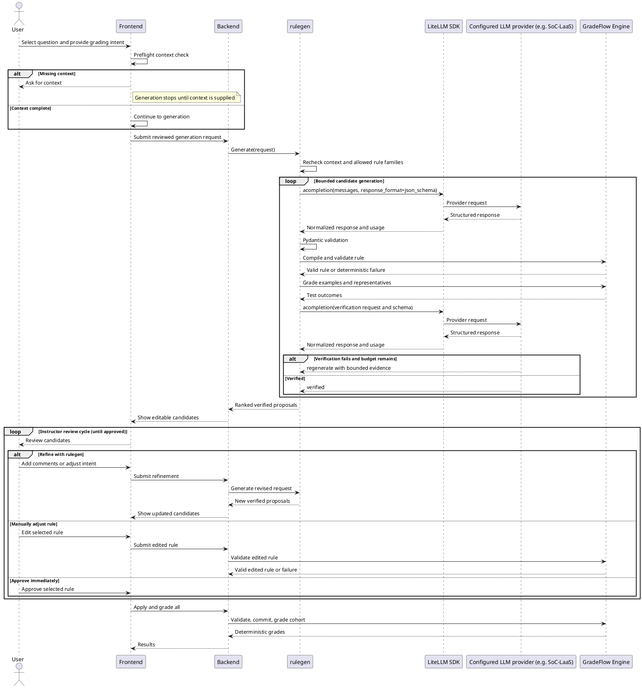

# `rulegen` Architecture

## Problem Statement

Instructors currently need to translate grading policy into rule by hand. This is slow and error-prone, especially when the policy depends on answer patterns or question context.

`rulegen` is an authoring-time tool that proposes editable rules from teacher intent and bounded examples; it does not apply rules or produce authoritative grades. GradeFlow remains deterministic at grading time.

## Design

`rulegen` is a stateless Python package for generating and verifying grading-rule proposals.

`GenerationRequest` is the sole request model. Its ordered `TargetTask` entries bind `QuestionTarget` or `GroupTarget` declarations to `TargetEvidence`. Shared answer cases live on the request; evidence cites them by case ID. `TargetLabelledCase` is the canonical teacher-labelled representation and owns the authoritative score for its target. Representative evidence contains counts without teacher scores. Preparation snapshots and validates the request, then derives sanitized LLM payloads, including `LLMTeacherLabelledExample` and `LLMTeacherLabelledAnswerTuple` for serialization.

Behavioral-contract expectations record the model's interpretation of grading intent. Actual execution results record what the compiled rule produced. Verification compares these with authoritative teacher labels when supplied, without treating model expectations or observed scores as teacher labels.

- It builds provider-independent prompts from a generation request and uses the LiteLLM Python SDK directly (`acompletion`) to call configured LLM providers.
- It treats every LLM response as untrusted and validates it against strict, request-scoped schemas.
- LiteLLM owns provider selection, API transport, and common response/error normalization. `rulegen` does not maintain a parallel provider-client interface or SoC-LaaS HTTP client unless a tested LiteLLM compatibility gap makes a small adapter necessary.
- The application supplies trusted provider, model, endpoint, and credential configuration to `rulegen`; secrets are never accepted from model output or written into prompts, provenance, or serialized generation results.
- LiteLLM transport does not replace RuleGen's strict local Pydantic validation, domain/catalog validation, bounded correction retries, token and prompt budgets, or non-secret call provenance.
- It uses two distinct types of LLM calls:
  - **Initial generation:** `rulegen` sends the teacher intent, question context, evidence, and allowed rule families to the LLM. The LLM proposes a rule strategy and behavioural contract. `rulegen` validates the response and compiles the strategy before testing it.
  - **Validation and refinement:** After the candidate is executed on bounded authoring cases, `rulegen` sends the candidate, behavioural contract, and representative engine testing results to the LLM. The LLM checks whether the rule matches the intended behaviour. A failed check triggers the regeneration of the candidate (within some budget) while a passed check returns the candidate back to the the backend.
- It always returns a candidate (best effort), even if the final regeneration fails the check (with a error/warning message ie which tests failed or rule itself is invalid).


## LiteLLM call boundary

`RuleGenerator(LiteLLMConfig(...))` receives trusted provider, model, API base, credentials, timeout, temperature, and per-call output-token settings. The generator directly awaits `litellm.acompletion` with text messages and a strict `json_schema` response format. LiteLLM handles routing and transport. RuleGen reads the untrusted assistant content plus model, request ID, finish reason, and token usage for validation, budgets, and provenance. Credentials and endpoint configuration stay outside prompts and serialized generation results.

SDK retries are disabled (`num_retries=0`, `max_retries=0`). RuleGen owns bounded correction retries and regeneration, and accounts for completed responses, including truncation, before retrying. Missing usage stops further generation because the token budget cannot be audited. Provider error bodies are not exposed in result diagnostics.

SoC-LaaS uses LiteLLM’s OpenAI-compatible route through an `openai/` model prefix; `provider="soc-laas"` selects its provenance label and schema compatibility behavior. Live probes on 2026-09-29 with LiteLLM 1.103.0 rejected `uniqueItems` in the original synthesis, grouped synthesis, verification, and request-scoped synthesis/verification schemas. Removing only that keyword made each request succeed. The probes used a 50-token cap to test schema acceptance, not full generation correctness. Consequently, `provider="soc-laas"` applies only this wire-schema translation; other providers retain the original schema. Local validation uses the original strict Pydantic models and domain/catalog checks, including uniqueness constraints. Provenance retains both schema hashes and removed keyword paths.

## Sequence Diagram



#### Additional Definition and Explanation
- **Request:** An immutable, versioned snapshot of the instructor's inputs and the trusted assessment context required for one `rulegen` generation. It should include:
  - **Target scope:** the selected question ID, or an explicitly persisted group ID with its ordered question IDs when the rule evaluates answer tuples across multiple questions.
  - **Teacher-labelled examples:** zero or more answers/answer tuples paired with authoritative expected marks. These examples must be distinguishable from system-selected test cases and would cover important positive, partial-credit, and negative cases as deemed necessary by the teacher.
  - **Teacher intent:** a prompt or comment describing the purpose of the rule, including what should receive full, partial, or no credit, required concepts, acceptable alternatives, and common errors or exclusions.
  - **References and assumptions:** optional answer keys, reference material, worked solutions, teacher-provided terminology, known assumptions, or policy clarifications that the rule should follow.
- **Pydantic validation:** Local structural validation of untrusted LLM responses against the exact original strict Pydantic response model, to ensure the payload is well-formed and matching the expected structure.
- **Compilation:** Deterministic translation of the intermediate representation (IR) from LLM into an engine-owned `QuestionRule` model without assigning durable IDs or modifying question metadata.
(maybe dont need this step, basically questionrule is quite simplified alr, so just need to inject a ruleid)
  - Example IR: 
    ```
    {
      "strategy": "text_match",
      "accepted_answers": ["Python", "JavaScript"]
    }
    ```
  - Example compilation:
    ```
    rule = compile_strategy(
      TextMatchStrategy(
          strategy="text_match",
          accepted_answers=["Python", "JavaScript"],
      ),
      target_question_id="q1",
      allowed_rule_kinds={"text_match"},
      question_type="TEXT",
    )
    ```
  - Example compiled engine rule:
    ```
    {
      "type": "TEXT_MATCH",
      "scope": "question",
      "question_id": "q1",
      "answers": ["Python", "JavaScript"],
      "display_name": "Text Match",
      "id": "temporary-engine-id"
    }
    ```
- **Engine-side validation:** Deterministic verification by the GradeFlow Engine (`validate_candidate` / `validate_rubric`) by overlaying the candidate onto the full rubric. The validation includes:
  - **Question existence:** Every question referenced by a rule must exist in the `QuestionSet`. 
  - **Rule-question compatibility:** The rule type must be supported by the referenced question's type. For example, `NUMBER_EQUAL` applied to a `NUMERIC` question is valid, while `NUMBER_EQUAL` applied to a `TEXT` question is invalid.
  - **Unique target questions:** Rules must not target the same question in a conflicting or ambiguous way. For example, if Rule A and Rule B both target `q1`, validation returns an error indicating that `q1` has multiple target rules.
  - **Safe execution semantics:** The validated rule structure and parameters must be safe for the engine to parse and execute.

- **Committing:** Persisting an approved rule into the assessment's official rubric in the database, and allocating a durable `rule_id` for new rules as well as marking the proposal revision as applied.

## `rulegen` in Deployment

- Run one asynchronous Nomad batch job for each `rulegen` request. The backend creates and persists a job record, including an immutable snapshot (necessary data for the request) of the generation request, before submitting the Nomad job. The database `job_id` is used as the Nomad job ID.
- The Nomad allocation runs a container image that includes both `rulegen` and the GradeFlow Engine. `rulegen` executes the complete workflow in the allocation and engine execution is local to the allocation, so the workflow does not call a separate backend-hosted Engine allocation.
- The allocation loads the request snapshot using `job_id`, then reports lifecycle and progress updates to the backend, which persists them in the job record. When the workflow completes, the allocation writes the proposal results and final status to the database. Failures are also recorded so that the backend can distinguish failed, cancelled, and completed jobs.
- The frontend polls the backend for the job status and proposal results and it does not communicate with Nomad or the allocation directly.
- Nomad provides allocation scheduling, isolation, resource limits, and restart behaviour. The backend remains responsible for request authorization, job-record persistence, submission, and mapping allocation outcomes to the externally visible job status. Submission and completion handling should be idempotent so that a retry cannot create duplicate proposal revisions.


1. group of qn in the rubric, need some kind of group context

2. mulitple generation -> instructor will be able to generate all and comeback to it so the draft rule genereated by rulegen should be persisted somewhere
