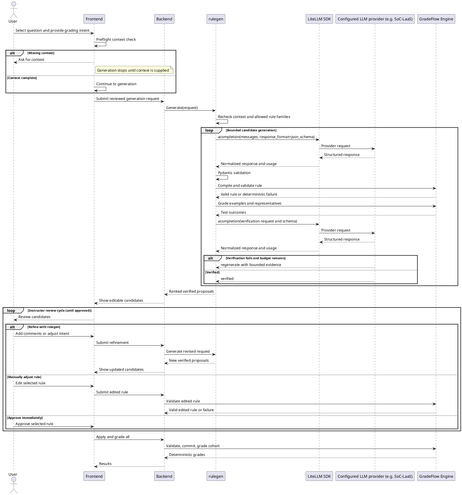

# `rulegen` Architecture

## Problem Statement

Instructors currently need to translate grading policy into rule by hand. This is slow and error-prone, especially when the policy depends on answer patterns or question context.

`rulegen` is an authoring-time tool that proposes editable rules from teacher intent and bounded examples; it does not apply rules or produce authoritative grades. GradeFlow remains deterministic at grading time.

## Design

`rulegen` is a stateless Python package for generating and verifying grading-rule proposals.

`GenerationRequest` is the sole request model. Its ordered `TargetTask` entries bind a `Target` with ordered `question_ids` to `TargetEvidence`. One ID selects single-question behavior; multiple IDs select grouped behavior, with no separately supplied group identity. Shared answer cases live on the request; evidence cites them by case ID. `TargetLabelledCase` is the canonical teacher-labelled representation and owns the authoritative score for its target. Representative evidence contains counts without teacher scores. Preparation uses the supplied request directly, runs `preflight_check()`, and derives sanitized LLM payloads. Callers must supply a valid `GenerationRequest` and must not mutate it or any nested objects while generation is running. Each disclosed case uses the same question-ID-to-answer map for a single question or a group, while labelled and representative evidence remain distinct.

The exported `LLMGenerationRequest` and `LLMGroupGenerationRequest` models are outbound projections. Their constructors validate serialization shape and disclosure bounds only; direct construction is not a supported request business-validation boundary. Build generation payloads from a valid, unmodified `GenerationRequest` with `build_llm_generation_payload()`. Evidence presence, source uniqueness, and group uniqueness belong to `TargetEvidence`, `Target`, and `GenerationRequest`.

Model case expectations record optional predicted scores and reasons for disclosed cases. Actual execution results record what the hydrated rule produced. Verification compares these with authoritative teacher case expectations when supplied, without treating model case expectations or observed scores as teacher labels.

- It builds provider-independent prompts from a generation request and uses the LiteLLM Python SDK directly (`acompletion`) to call configured LLM providers.
- It treats every LLM response as untrusted and validates it against strict, request-scoped schemas.
- LiteLLM owns provider selection, API transport, and common response/error normalization. `rulegen` does not maintain a parallel provider-client interface or SoC-LaaS HTTP client unless a tested LiteLLM compatibility gap makes a small adapter necessary.
- The application supplies trusted provider, model, endpoint, and credential configuration to `rulegen`; secrets are never accepted from model output or written into prompts or serialized generation results.
- LiteLLM transport does not replace RuleGen's strict local Pydantic validation, bounded correction retries, or token budgets.
- It uses generation and verification phases in the same conversation:
  - **Initial generation:** `rulegen` sends the teacher intent, question context, evidence, and allowed rule families to the LLM. The LLM proposes an engine-shaped rule payload and model case expectations. `rulegen` hydrates trusted fields, checks authoring field and family policy against the original input, constructs the original engine model, and delegates semantic validation to the engine before testing it.
  - **Execution and verification:** After the candidate is executed on bounded authoring cases, `rulegen` sends the candidate, model case expectations, and representative engine testing results to the LLM. The LLM checks whether the rule matches the intended behaviour. A failed check triggers the regeneration of the candidate (within the existing per-target budget) while a passed check returns the candidate back to the backend.
- Each phase’s user turn carries only that phase’s instructions before the untrusted JSON request payload; regeneration reuses generation instructions. Accepted turns are replayed verbatim. Each user turn identifies generation, verification, or regeneration and includes the active response schema. Accepted turns and validated assistant JSON, including verdicts, are retained without summarizing or silently truncating the original teacher request. Malformed and truncated replies are excluded; format retries replay only accepted history plus bounded diagnostics.
- Deterministic validation, execution, or score failures go directly to regeneration. Otherwise verification explicitly returns `verified` or `regenerate`, assessing normalized engine settings, defaults, and observed behavior against original teacher intent. Summaries and case reasons never become a replacement contract. Representative case expectations may change only with reasons explaining corrections against teacher intent; teacher-labelled scores remain fixed. Every regenerated candidate must execute and pass explicit verification again. All calls and replayed history consume existing budgets.
- Only successfully verified candidates become applyable proposals. Failed or exhausted attempts return diagnostics and an unresolved/no-safe-candidate status without an applyable proposal.

## LiteLLM call boundary

`RuleGenerator(LiteLLMConfig(...))` receives trusted provider, model, API base, credentials, timeout, temperature, and per-call output-token settings. The generator directly awaits `litellm.acompletion` with text messages and a strict `json_schema` response format. LiteLLM handles routing and transport. RuleGen reads the untrusted assistant content plus finish reason and reported total-token usage for failure handling and budgets. Credentials and endpoint configuration stay outside prompts and serialized generation results.

SDK retries are disabled (`num_retries=0`, `max_retries=0`). RuleGen owns bounded correction retries and regeneration, and accounts for completed responses, including truncation, before retrying. Missing usage stops further generation because the token budget cannot be audited. Provider error bodies are not exposed in result diagnostics.

Provider schema adaptation removes unsupported annotations such as `uniqueItems` separately from local parsing. JSON Schema edits never change Pydantic validators. Local engine parsing intentionally permits normal coercion, including numeric strings and arrays becoming sets.

SoC-LaaS uses LiteLLM’s OpenAI-compatible route through an `openai/` model prefix; `provider="soc-laas"` configures its trusted routing label. RuleGen's Pydantic response models do not emit provider-unsupported JSON Schema keywords. Local validation enforces domain constraints, including uniqueness, independently of the schema sent to the provider.

## Sequence Diagram

#### Additional Definition and Explanation

- **Request:** Immutable instructor intent, policy clarifications, trusted question context, and optional teacher-labelled examples. Targets contain ordered question IDs; multiple IDs define an explicit group.
- **Authoring boundary:** Request-specific schemas discover engine-compatible models and all declared input fields, excluding blocked families and protected metadata. New engine families and fields are available automatically unless blocked; nested rule contexts remain engine-owned.
- **Provider contract:** `RuleGenerator.generate()` requires strict JSON Schema output. The provider enforces the authoring schema, including protected and unknown field exclusion, while hydration only transforms payloads and populates trusted fields. Declared-group membership is not enforced locally or constrained in the provider schema. The outer response model validates the response envelope.
- **Hydration and parsing:** Trusted context supplies single-question IDs; grouped rules author IDs subject to engine validation against the full assessment, in any engine-permitted order. Original engine models supply defaults, validators, and normal Pydantic coercion, without UI overrides.
- **Rulegen validation:** Validates response envelopes. The strict provider schema enforces allowed families and field permissions. Engine parsing and rubric validation own rule semantics and compatibility. Model predictions may omit cases; supplied predictions and teacher labels are compared with actual engine scores after execution.
- **Synthesis response:** Strict `{outcome, result}` envelopes carry candidate summary, rule, and model case expectations, or refusal reason, explanation, and optional teacher actions.
- **Engine validation:** Overlays the candidate onto the full rubric to check question existence, rule compatibility, target uniqueness, and safe execution before grading.
- **Committing:** The backend persists an instructor-approved rule, assigns its durable ID, and marks the proposal revision as applied.

## `rulegen` in Deployment

- Run one asynchronous Nomad batch job for each `rulegen` request. The backend creates and persists a job record, including an immutable snapshot (necessary data for the request) of the generation request, before submitting the Nomad job. The database `job_id` is used as the Nomad job ID.
- The Nomad allocation runs a container image that includes both `rulegen` and the GradeFlow Engine. `rulegen` executes the complete workflow in the allocation and engine execution is local to the allocation, so the workflow does not call a separate backend-hosted Engine allocation.
- The allocation loads the request snapshot using `job_id`, then reports lifecycle and progress updates to the backend, which persists them in the job record. When the workflow completes, the allocation writes the proposal results and final status to the database. Failures are also recorded so that the backend can distinguish failed, cancelled, and completed jobs.
- The frontend polls the backend for the job status and proposal results and it does not communicate with Nomad or the allocation directly.
- Nomad provides allocation scheduling, isolation, resource limits, and restart behaviour. The backend remains responsible for request authorization, job-record persistence, submission, and mapping allocation outcomes to the externally visible job status. Submission and completion handling should be idempotent so that a retry cannot create duplicate proposal revisions.
